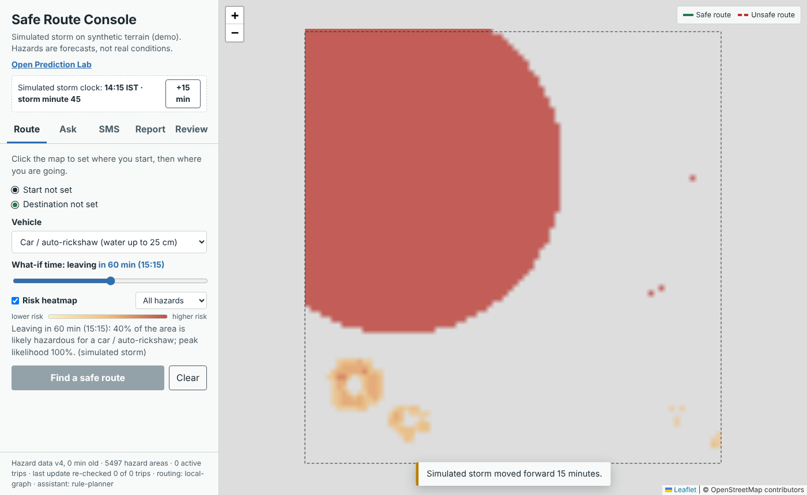
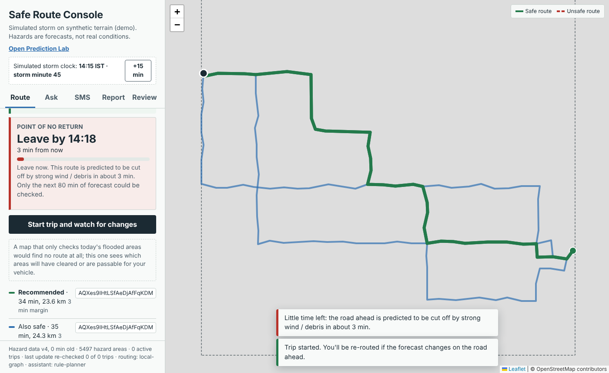
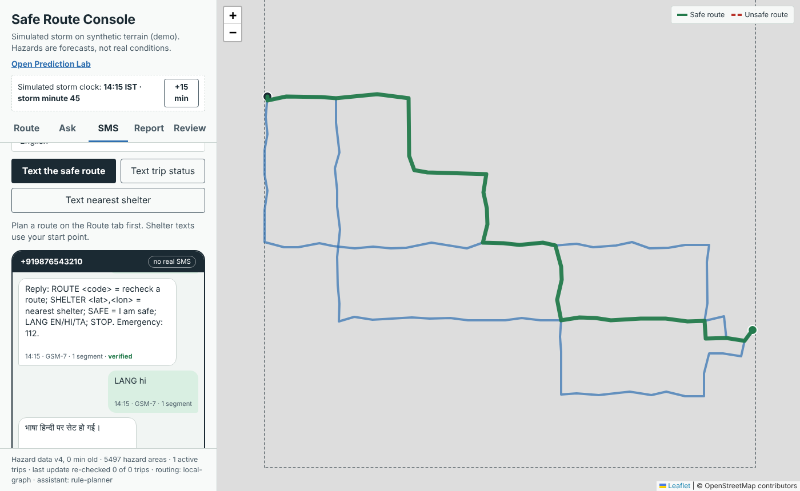

# Disaster-Aware Intelligent Routing System

> **Confidential until the patent application is filed.** This branch contains an unfiled invention
> (modules M1–M6). Keep the repository **private** and do not demo, publish or upload it until the VIT
> IPR & Technology Transfer Cell confirms that a provisional application has been filed.

The system recommends routes that stay safe **for your vehicle at the time you will actually reach each road**
during floods, landslides and storms, keeps trips safe as the forecast changes, and answers questions through an
assistant whose safety statements are checked against live data before they are shown.

```
Browser (Leaflet console)
   │  Google sign-in, roles
   ▼
Spring Boot gateway  (this repo, Java 17)
   ├── /engine/**  ──────────────►  Safety engine (safety-engine/, Python, FastAPI)
   │                                  M1 calibrated multi-horizon hazard model
   │                                  M2 probability-parameterised, terrain-specific hazard geometry
   │                                  M3 arrival-time, vehicle-specific route feasibility (spatio-temporal index)
   │                                  M4 engine-agnostic detour synthesis (no graph re-preprocessing)
   │                                  M5 incremental re-validation of active trips + anti-herding
   │                                  M6 verified LLM guidance gate (English / Hindi / Tamil)
   │                                  M7 auditable route decision records + point forecast attribution
   │                                  + evidence fusion (SACHET/CAP alerts, crowd reports, sensors), offline packs
   └── /api/route, /api/disaster/predict, /geo-ai/ask   (original endpoints, kept as the baseline)
```

## Quick start

**Fastest (engine only, no Java, no Google keys):**

```bash
cd safety-engine
pip install -r requirements.txt
uvicorn safe_engine.api:app --port 8000
# open http://localhost:8000  — the console runs against a simulated storm
```

**Whole system with Docker:**

```bash
docker compose up --build
# http://localhost:8080 (gateway, Google sign-in)   http://localhost:8000 (engine directly)
```

**Gateway from source:** copy `src/main/resources/application.properties.example` to
`application.properties`, fill in Google OAuth credentials and `app.admin-emails` (or set
`app.security.enabled=false` for local testing), start the engine, then `./mvnw spring-boot:run`.

## What is where

| Path | Contents |
|---|---|
| `safety-engine/safe_engine/` | Engine modules (see `safety-engine/README.md`) |
| `safety-engine/tests/` | `pytest` suite (16 tests) |
| `safety-engine/evaluation/` | Benchmark harness and `results/RESULTS.md` (simulation results for the IDF / patent) |
| `REVIEW.md` | Examiner / reviewer guide: novelty (M1–M7), demo script, reproduction steps |
| `src/main/java/.../EngineProxyController.java` | Gateway: forwards `/engine/**` with user identity, role and shared key |
| `src/main/resources/static/index.html` | New safety console (`legacy.html` is the original page) |
| `docker-compose.yml`, `render.yaml` | Deployment |

## Original features (still available)

- `POST /api/route` – OSRM routes filtered by a circular disaster zone
- `GET /api/disaster/predict` – Weka Random Forest on the city-weather CSV. **Note:** in
  `india_disaster_weather_dataset_500_rows.csv` the labels do not depend on the features (e.g. "Earthquake"
  rows predicted from rainfall), so this model cannot learn a real signal. It is kept only as baseline B3;
  the calibrated M1 model replaces it.
- `POST /geo-ai/ask` – Groq answer without verification (baseline for M6)

## Simulated vs real data

By default the engine runs in **scenario mode**: synthetic terrain placed at Chennai coordinates and a
simulated storm with a hidden ground truth, so everything works offline and can be evaluated. The UI labels
this clearly. For real use set `ENGINE_MODE=live`, `DEM_PATH` (ESRI ASCII grid from SRTM/CartoDEM),
`ROUTING_ENGINE=osrm`, `SHELTERS_PATH`, and retrain M1 on observed rainfall and recorded flooding.

## New in this branch: leave-by warning, SMS fallback, risk heatmap

Run the engine (`cd safety-engine && uvicorn safe_engine.api:app --port 8000`) and open http://localhost:8000.

| Heatmap + what-if slider | Leave-by ("point of no return") | SMS fallback (simulated) |
|---|---|---|
|  |  |  |

Tests: `cd safety-engine && python -m pytest tests/test_features.py`. Benchmark: `python -m evaluation.run_eval --only-e8`.
